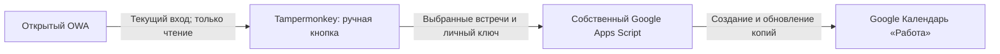

# OWA Calendar Bridge

Ручная синхронизация своего календаря из открытого Outlook Web App в отдельный Google Календарь «Работа».

Когда корпоративное подключение уже включено и OWA открыт, нажмите **«Синхронизировать»**. Скрипт использует текущий вход в OWA и переносит названия, время, место, описания и ссылки на звонки. Следующий запуск обновляет существующие копии.

 

## Быстрый старт

Откройте [INSTALL.html](INSTALL.html) из скачанной папки в браузере. Там есть кнопки копирования обоих скриптов и пошаговая установка. Для установки не нужны Node.js, терминал или консоль браузера.

**Каждый пользователь создаёт собственный проект Google Apps Script в своём Google аккаунте.** Пользователи получают одинаковый код, но разные адреса обработчиков, ключи и календари.

1. В Tampermonkey выберите **«Создать новый скрипт»**, замените шаблон содержимым [owa-google-sync.user.js](owa-google-sync.user.js) и сохраните.
2. В нужном Google аккаунте откройте [Google Apps Script](https://script.google.com/home/start). Создайте проект и замените содержимое `Code.gs` кодом из [GoogleCalendarBridge.gs](GoogleCalendarBridge.gs).
3. **Развернуть → Новое развертывание → Веб-приложение**. Выполнять от имени: **Я**. У кого есть доступ: **Все**, включая пользователей без входа в Google. Разверните приложение и разрешите своему проекту доступ к календарям.
4. Выберите функцию **`setup`** в списке рядом с «Выполнить» и запустите её. В журнале будет ссылка `/exec#ключ`. Если показан только ключ, возьмите адрес `/exec` из окна развертывания и допишите к нему `#` и ключ без пробелов.
5. Перезагрузите обычную авторизованную вкладку OWA. На панели справа снизу нажмите **⚙**, вставьте ссылку подключения и сохраните.
6. Нажмите **«Синхронизировать»**. В Google появится отдельный календарь «Работа».

Ссылку подключения с ключом храните только у себя. Для обмена с коллегами отправляйте код или архив установки.

## Как это работает



| Кнопка | Действие |
| --- | --- |
| Синхронизировать | Чтение OWA и обновление копий в Google |
| Просмотр | Чтение и показ названий без передачи встреч в Google |
| Скачать ICS | Разовый экспорт с полными данными без подключения Google |
| ⚙ | Адрес обработчика и период синхронизации |

По умолчанию синхронизируются последние **7 дней** и ближайшие **60 дней**; в настройках доступны 30, 60 и 90 дней вперёд. Между запусками обновления не поступают. Повторный импорт файла ICS не заменяет синхронизацию и может создавать дубли.

Встречи с повторением разворачиваются в отдельные события внутри выбранного периода. Участники не добавляются, приглашения и ответы организаторам не отправляются. Копии не предназначены для редактирования рабочего календаря.

Исчезнувшие встречи удаляются только после успешного чтения полного списка OWA и успешной передачи всех событий. При ошибке чтения передачи нет. При ошибке Google часть событий может обновиться, но очистка не запускается; следующий запуск повторяет синхронизацию. Если сервер не подтвердил полноту списка, удаления пропускаются.

## Требования и ограничения

- Tampermonkey и разрешённый в браузере запуск userscript.
- OWA по HTTPS с путём `/owa/`, активный вход и необходимое корпоративное подключение.
- Доступ к Google Apps Script и возможность развернуть собственное веб-приложение.
- Разрешение организации на перенос выбранных рабочих данных в выбранный Google аккаунт.

Ручная синхронизация подтверждена пользователем на одном сервере OWA. Совместимость со всеми версиями Exchange не проверена: скрипт использует внутренний JSON-интерфейс OWA. Outlook в Microsoft 365 с другим интерфейсом, отдельные домены авторизации и нестандартные пути могут потребовать адаптации.

Часовой пояс календаря и событий на весь день — **Europe/Moscow**. Обрабатывается до 1000 событий за один запуск. Описания ограничены 16 000 символами до HTML-экранирования; вложения, изображения и списки участников не копируются. Не превращайте копии вручную в серии.

Userscript запускается на HTTPS-страницах с путём `/owa/`; опубликованные страницы `/owa/calendar/` исключены. Он не делает фоновой синхронизации. Запросы чтения идут на тот же сервер, где открыт OWA. Обработчик закрепляет каждый профиль за первым использованным сервером.

## Если что-то не работает

**Нет кнопки:** проверьте, что userscript включён и браузер разрешает его запуск. Перезагрузите обычную вкладку OWA; публичная `calendar.html` не подходит.

**Ссылка не принимается:** нужна строка `https://script.google.com/macros/s/…/exec#ключ`. Адрес из окна развертывания сам по себе ключа не содержит. Функция `showConnectionKey` показывает существующий ключ. Выбор функции в верхнем списке обязателен: добавление функции в редактор не меняет выбранную функцию автоматически.

**Google требует входа:** откройте **Управление развертываниями → своё веб-приложение → карандаш**. Выполнять от имени: **Я**, доступ: **Все**, включая пользователей без входа. Проверка: адрес `/exec` без ключа в инкогнито должен показывать JSON с `OWA Calendar Bridge`.

**В опубликованной версии нет `doPost`:** обновите существующее развертывание до версии с кодом обработчика. Сохранение кода в редакторе не обновляет уже опубликованную версию.

**OWA отклонил запрос:** проверьте корпоративное подключение и повторно войдите обычным способом. Передайте сопровождающему текст ошибки с панели; не прикладывайте cookie, HAR или содержимое встреч.

## Обновление

Для userscript замените код существующего скрипта в Tampermonkey, сохранив его запись и настройки. Для Google замените код и обновите существующее развертывание. Календарь и ключ хранятся в свойствах проекта, а не в исходном коде.

## Для разработчиков

Требуется Node.js 22.19+.

```sh
npm ci
npm test
```

Тесты используют искусственные ответы OWA, имитацию Google Calendar и DOM. Они проверяют обновления без дублей, повторения, отмены, обработку сбоев, часовые пояса, удаление только собственных копий и отсутствие корпоративных идентификаторов и cookie в передаваемых данных. Они не выполняют реальные запросы к корпоративной почте или Google.

`npm run build` собирает автономную страницу `INSTALL.html` с актуальным кодом обоих скриптов. `npm run check:sharing` проверяет публикуемые файлы и вложенный код страницы установки на признаки личных подключений и секретов.

Правила безопасного обмена и смена ключа: [SECURITY.md](SECURITY.md). Состав файлов: [docs/SHARING.md](docs/SHARING.md). Изменения: [CHANGELOG.md](CHANGELOG.md).

## Лицензия

[MIT](LICENSE). Это независимый инструмент; он не является официальным продуктом работодателя, Microsoft или Google.
